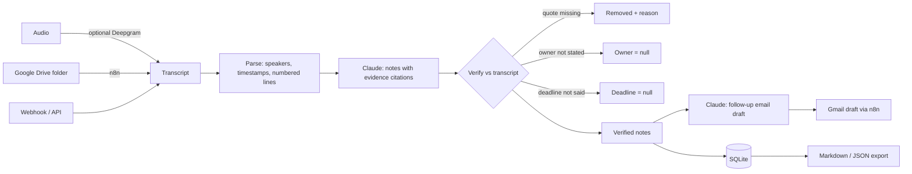

# AI Meeting Assistant

Turns meeting transcripts (plain text, WebVTT or SRT — or audio via optional speech-to-text) into a **summary, decisions, action items and a follow-up email draft** using **Claude**. Every decision and action item must cite the transcript line it came from, and code **verifies** that the quote exists, that an owner was actually assigned or volunteered, and that a deadline was actually said. Anything unsupported is removed or left unassigned — the assistant never invents decisions, owners or dates.

> Part of [Mawra Janjua's AI automation portfolio](https://github.com/Mawra-Janjua).

## Features

| Capability | Details |
|---|---|
| Input | JSON `{title?, date?, attendees?, transcript}` · raw `.txt` / `.vtt` / `.srt` upload · audio via `/api/transcribe` (optional Deepgram) |
| Parsing | Speaker labels (`Name:`, `[Name]`, `<v Name>`, `Speaker 1:`), caption timestamps, numbered lines `[L12]` |
| Claude notes | Summary, key points, decisions, action items (task, owner, deadline), open questions — each decision/action with `evidence_line` + `evidence_quote` |
| Verification | Quote must exist (wrong line numbers corrected; spanning captions handled) · owner kept only if named in the cited/previous line or the speaker made a first-person commitment ("I'll…") · deadline kept only if said nearby · duplicates merged · removed items listed with reasons |
| Follow-up email | Second Claude call that receives **only verified items**; unassigned tasks shown as "Owner: TBD". n8n saves it as a Gmail **draft** — nothing is sent automatically |
| Export | Markdown (decision sources, action table) and JSON |

## Architecture



Details: [docs/ARCHITECTURE.md](docs/ARCHITECTURE.md).

## Quick start

Requires Node.js 22.18+.

```bash
npm install
cp .env.example .env   # set API_KEY and ANTHROPIC_API_KEY (DEEPGRAM_API_KEY optional)
npm start              # http://localhost:4104
```

```bash
# Raw transcript file, metadata in the query string
curl -X POST "http://localhost:4104/api/meetings?title=Product%20sync&date=2026-11-09" \
  -H "x-api-key: $API_KEY" -H "content-type: text/plain" \
  --data-binary @test/fixtures/product-sync.txt

# Markdown notes
curl -H "x-api-key: $API_KEY" http://localhost:4104/api/meetings/<id>/export.md
```

### Optional speech-to-text

Set `DEEPGRAM_API_KEY`, then:

```bash
curl -X POST http://localhost:4104/api/transcribe -H "x-api-key: $API_KEY" \
  -H "content-type: audio/mpeg" --data-binary @meeting.mp3
```

The response contains a diarized transcript (`Speaker 1: …`) to pass to `/api/meetings`. Speaker labels from audio are anonymous; add `attendees` or rename speakers before summarising if you want named owners.

## Docker Compose

```bash
cp .env.example .env && docker compose up -d --build   # API :4104, n8n :5678
```

## n8n workflows

| File | Flow |
|---|---|
| `n8n/transcript-webhook.workflow.json` | `POST /webhook/meeting-transcript` (JSON) → `/api/meetings` → respond with notes + create a Gmail **draft** of the follow-up |
| `n8n/google-drive-transcripts.workflow.json` | New file in a Drive folder (every 10 min) → download → `/api/meetings` (txt/vtt/srt) → Gmail draft |

n8n environment: `MEETING_API_URL`, `MEETING_API_KEY`, `TRANSCRIPTS_FOLDER_ID`. Select your Gmail and Google Drive credentials after import.

## API

All `/api/*` routes need `x-api-key`. `?followUp=false` skips the email draft.

| Method & path | Description |
|---|---|
| `GET /health` | Public. Claude + speech-to-text status |
| `POST /api/meetings` | JSON or `text/plain` / `text/vtt` / `application/x-subrip` (with `?title=&date=&attendees=a,b`) |
| `POST /api/analyze` | Same, stores nothing; also returns Markdown (portfolio demo) |
| `POST /api/transcribe` | Audio body (`audio/mpeg`, `audio/wav`, `audio/mp4`, `audio/webm`, …) → transcript |
| `GET /api/meetings` | List |
| `GET /api/meetings/:id` | Notes, follow-up, metadata |
| `GET /api/meetings/:id/export.md` · `/export.json` | Downloads |

## Testing

```bash
npm run typecheck
npm test
```

27 tests: text/VTT/SRT parsing and speaker detection (including sentences with colons); verification with a scripted model output that contains a hallucinated decision, a hallucinated task, an unassigned owner, an unspoken deadline, a wrong line number and a duplicate; ownership rules (commitment vs. merely speaking nearby); follow-up generated only from verified items; Markdown export; HTTP (JSON and raw VTT, validation, 401/404/415/503); the real Anthropic SDK against a mock Messages API; Deepgram request shape, diarization formatting and error mapping; n8n JSON structure.

## Troubleshooting

See [docs/TROUBLESHOOTING.md](docs/TROUBLESHOOTING.md).

## License

MIT
