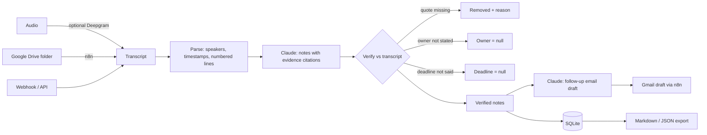

# AI Meeting Assistant

Turns meeting transcripts (plain text, WebVTT or SRT — or audio via optional speech-to-text) into a **summary, decisions, action items and a follow-up email draft** using **Claude**. Every decision and action item must cite the transcript line it came from, and code **verifies** that the quote exists, that an owner was actually assigned or volunteered, and that a deadline was actually said. Anything unsupported is removed or left unassigned — the assistant never invents decisions, owners or dates.

> Part of [Mawra Janjua's AI automation portfolio](https://github.com/Mawra-Janjua).

## Features

| Capability | Details |
|---|---|
| Input | JSON `{title?, date?, attendees?, transcript}` · raw `.txt` / `.vtt` / `.srt` upload · audio via `/api/meetings/audio` (optional Deepgram: transcribe → summarise → store) |
| Parsing | Speaker labels (`Name:`, `[Name]`, `<v Name>` incl. several voices per cue, `Speaker 1:`), Teams/Zoom layout (name on its own line, optional timestamp), caption timestamps, numbered lines `[L12]` |
| Claude notes | Summary, key points, decisions, action items (task, owner, deadline), open questions — each decision/action with `evidence_line` + `evidence_quote` |
| Verification | Quote (12+ chars) must exist (wrong line numbers corrected; spanning captions handled) · the decision/task text must share key words with the quoted line, so a real quote cannot back an invented item · owner kept only if named in the cited/previous line or the speaker made a first-person commitment ("I'll…") · deadline kept only if said nearby (whole words) · duplicates merged · removed items listed with reasons |
| Due dates | Deadlines stay as spoken (`"deadline": "by Friday"`) and get `dueDate` (`YYYY-MM-DD` or `null`) computed **in code** from the meeting `date`: today/tomorrow, weekdays ("Friday" = next one on/after the meeting; "next Friday" = the following week), end of week/month, "in N days/weeks", ISO, "12 March"/"March 12" (next occurrence). Vague phrases or no meeting date → `null` |
| Follow-up email | Second Claude call, only when there are decisions, action items or open questions; it receives **only verified items**; unassigned tasks shown as "Owner: TBD". n8n saves it as a Gmail **draft** — nothing is sent automatically |
| Idempotency | `Idempotency-Key` header on `POST /api/meetings` and `/api/meetings/audio`: a retry returns the stored meeting (`200`, `idempotent-replayed: true`) instead of calling Claude again |
| Export | Markdown (decision sources, action table) and JSON |

## Architecture



Details: [docs/ARCHITECTURE.md](docs/ARCHITECTURE.md).

## Quick start

Requires Node.js 22.18+.

```bash
npm install
cp .env.example .env   # set ANTHROPIC_API_KEY (DEEPGRAM_API_KEY optional) and API_KEY
node -e "console.log(crypto.randomUUID())"   # generate an API_KEY
npm start              # http://127.0.0.1:4104
```

**Authentication.** When `API_KEY` is set, every `/api/*` route requires the `x-api-key` header (only `/health` is public). By default the server listens on `127.0.0.1`; with `API_KEY` empty it runs unauthenticated **on this machine only**. With any non-loopback `HOST` (e.g. `0.0.0.0`, which Docker uses) the server refuses to start unless `API_KEY` is set and at least 16 characters long.

```bash
# Raw transcript file, metadata in the query string
curl -X POST "http://localhost:4104/api/meetings?title=Product%20sync&date=2026-11-09" \
  -H "x-api-key: $API_KEY" -H "content-type: text/plain" \
  --data-binary @test/fixtures/product-sync.txt

# Markdown notes
curl -H "x-api-key: $API_KEY" http://localhost:4104/api/meetings/<id>/export.md
```

### Optional speech-to-text

Set `DEEPGRAM_API_KEY`, then send audio straight through the full pipeline (transcribe → summarise → verify → store):

```bash
curl -X POST "http://localhost:4104/api/meetings/audio?title=Weekly%20sync&date=2026-11-09" \
  -H "x-api-key: $API_KEY" -H "content-type: audio/mpeg" --data-binary @meeting.mp3
```

`/api/transcribe` still returns only the diarized transcript (`Speaker 1: …`) if you want to edit it first. Speaker labels from audio are anonymous, so owners usually stay unassigned unless people are named in the speech. Without `DEEPGRAM_API_KEY` both endpoints return `503 stt_not_configured`.

## Configuration

| Variable | Default | Purpose |
|---|---|---|
| `PORT` | `4104` | HTTP port |
| `HOST` | `127.0.0.1` | Listen address. Non-loopback values require `API_KEY` (Docker sets `0.0.0.0`) |
| `API_KEY` | – | `x-api-key` value for `/api/*`, min. 16 characters |
| `TRUST_PROXY` | `false` | `true` only behind a trusted reverse proxy: rate limiting then uses `X-Forwarded-For` |
| `ANTHROPIC_API_KEY` | – | Required for summaries (otherwise `503 ai_not_configured`) |
| `CLAUDE_MODEL` | `claude-opus-5-5` | Model id |
| `CLAUDE_FALLBACKS` | `default` | `default` enables server-side refusal fallback; `off` disables it |
| `DATABASE_PATH` | `./data/meetings.db` | SQLite file |
| `RATE_LIMIT_PER_MINUTE` | `20` | Per client, `/api/*` |
| `MAX_BODY_MB` | `50` | Request body limit (audio uploads) |
| `MAX_TRANSCRIPT_LINES` | `5000` | Longer transcripts get `422` |
| `FOLLOWUP_SENDER` | `the meeting organiser` | Name used in follow-up drafts |
| `DEEPGRAM_API_KEY` | – | Optional speech-to-text |
| `DEEPGRAM_MODEL` | `nova-3` | Deepgram model |
| `TRANSCRIPTS_FOLDER_ID` | – | n8n Drive workflow: folder to watch (passed to n8n by Compose) |

Timeouts: one request can take several minutes (each Claude call has a 300 s timeout plus SDK retries; Deepgram 600 s). Node's `requestTimeout` only limits how long a client may take to *send* the request, so the server sets it to 30 min (large audio uploads), `headersTimeout` to 60 s, and disables the socket inactivity timeout so long Claude calls are not cut off. Clients should wait at least 15 minutes and send an `Idempotency-Key` when they retry.

## Docker Compose

```bash
cp .env.example .env           # API_KEY is required: the container listens on 0.0.0.0
docker compose up -d --build   # API :4104, n8n :5678
```

## n8n workflows

| File | Flow |
|---|---|
| `n8n/transcript-webhook.workflow.json` | `POST /webhook/meeting-transcript` (JSON, Header Auth) → `/api/meetings` → respond with notes + create a Gmail **draft** of the follow-up. API still failing after 3 tries → `502` JSON error response |
| `n8n/google-drive-transcripts.workflow.json` | New file in a Drive folder (every 10 min) → download → `/api/meetings` (txt/vtt/srt) → Gmail draft. API still failing after 3 tries → Stop and Error (execution marked failed) |

Import and setup:

1. In n8n open **Workflows → Import from File** and choose each JSON file from `n8n/` (Compose also mounts them read-only at `/workflows`).
2. Create credentials (**Credentials → Add credential**) and select them in the nodes that show a warning:
   - **Google Drive OAuth2 API** ("Google Drive account"): Drive trigger and download.
   - **Gmail OAuth2 API** ("Gmail account"): draft creation.
   - **Header Auth** named "Meeting API webhook auth": e.g. header `x-webhook-key` with a long random value. Callers of the webhook must send that header.
3. Set n8n environment variables: `MEETING_API_URL` (e.g. `http://meeting-api:4104` in Compose), `MEETING_API_KEY` (the API's `API_KEY`), and `TRANSCRIPTS_FOLDER_ID` for the Drive flow. Nodes read them via `$env`, so `N8N_BLOCK_ENV_ACCESS_IN_NODE=false` must be set (as in `docker-compose.yml`).
4. Activate the workflows.

Retries without duplicates: both API calls retry 3 times and wait up to 15 minutes each. Every call sends an `Idempotency-Key` (`drive-<file id>` for Drive; for the webhook, the caller's own `Idempotency-Key` header if present, otherwise `n8n-webhook-<execution id>`), so a retry after a timeout returns the stored meeting instead of creating a duplicate. Callers that retry the webhook themselves should send their own `Idempotency-Key`.

Gmail recipients: in the webhook flow the draft's "To" is filled with the attendees that are email addresses (`"attendees": ["sara@example.com", …]`). Attendees given as plain names, and all Drive-flow meetings, produce a draft **without a recipient** for the reviewer to fill in before sending.

## API

When `API_KEY` is set, all `/api/*` routes need `x-api-key` (see Authentication above). `?followUp=false` skips the email draft. Empty query values (`?date=`) are treated as absent.

| Method & path | Description |
|---|---|
| `GET /health` | Public. Claude + speech-to-text status |
| `POST /api/meetings` | JSON or `text/plain` / `text/vtt` / `application/x-subrip` (with `?title=&date=&attendees=a,b`). Optional `Idempotency-Key` header: `201` created, `200` + `idempotent-replayed: true` on a repeat, `422` if the key was used for a different transcript |
| `POST /api/meetings/audio` | Audio body (`audio/mpeg`, `audio/wav`, `audio/mp4`, `audio/webm`, …) with the same query metadata → Deepgram transcript → notes → stored meeting. Optional `Idempotency-Key`. `503` if `DEEPGRAM_API_KEY` is not set |
| `POST /api/analyze` | Like `/api/meetings` with a transcript, but stores nothing; also returns Markdown (portfolio demo) |
| `POST /api/transcribe` | Audio body → transcript only |
| `GET /api/meetings` | List |
| `GET /api/meetings/:id` | Notes, follow-up, metadata |
| `GET /api/meetings/:id/export.md` · `/export.json` | Downloads (Markdown deadline column shows `Friday (2026-11-13)`) |

Action items have the shape `{ task, owner, deadline, dueDate, line, quote, notes }`: `deadline` exactly as spoken, `dueDate` resolved in code (or `null`).

## Testing

```bash
npm run typecheck
npm test
```

63 tests, no network or API keys needed: text/VTT/SRT/Teams/Zoom parsing and speaker detection (sentences with colons, several voices in one VTT cue); verification with a scripted model output that contains a hallucinated decision, a hallucinated task, an unassigned owner, an unspoken deadline, a wrong line number and a duplicate; text/quote overlap and minimum quote length; whole-word deadline matching ("Mon" vs "money", the verb "may"); deterministic due-date resolution; ownership rules; follow-up only when there is something to follow up and only from verified items; idempotent creation (sequential and concurrent) and SQLite migration; Markdown export; HTTP (JSON, raw VTT, empty query values, the audio pipeline with an injected Deepgram fetch, 401/404/415/502/503, `TRUST_PROXY`); config parsing; the shared HTTP security layer; the real Anthropic SDK against a mock Messages API; n8n workflow structure, placeholder credentials, secret scan, retries, error branches and webhook auth.

## Real execution test

The unit tests never call Claude. To check the real integration end to end:

```bash
ANTHROPIC_API_KEY=... npm run live-check   # or put the key in .env
```

It summarises `test/fixtures/product-sync.txt` once with the real `ClaudeClient` (model from `CLAUDE_MODEL`), runs verification and prints the notes, rejected items and timing. This costs a small amount of Anthropic credit (one notes call, no follow-up). Without `ANTHROPIC_API_KEY` it prints which variable is missing and exits with code 2. It never prints a fake result.

## Troubleshooting

See [docs/TROUBLESHOOTING.md](docs/TROUBLESHOOTING.md).

## License

MIT
