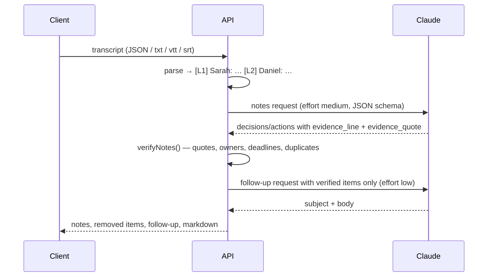

# Architecture

| Module | Responsibility |
|---|---|
| `src/transcript.ts` | Format detection, parsing (text/VTT/SRT), speaker extraction, numbered lines, text normalisation |
| `src/ai.ts`, `src/claude.ts` | Claude notes (with evidence) and follow-up email, structured outputs |
| `src/verify.ts` | Evidence, owner and deadline verification; dedupe; rejected-item log |
| `src/stt.ts` | Optional Deepgram pre-recorded transcription with diarization |
| `src/service.ts` | Pipeline orchestration and limits |
| `src/export.ts` | Markdown rendering |
| `src/store.ts` | SQLite persistence |

## Pipeline

## Verification rules

| Item | Kept when | Otherwise |
|---|---|---|
| Decision / action | Normalised `evidence_quote` is in the cited line, an adjacent line, two consecutive caption lines, or anywhere in the transcript (line number corrected) | Removed, listed under `rejected` with the reason |
| Owner | Named in the cited line or the line before it ("Daniel, can you…"), **or** the cited line's speaker made a first-person commitment ("I'll…", "I can…", "will do") | `owner: null`, note added |
| Deadline | The deadline words appear within ±2 lines of the cited line | `deadline: null`, note added |
| Pronoun owners ("I", "we", "the team") | Never accepted as names | `owner: null` |

These are deterministic and tested, so the guarantees hold regardless of how the model behaves.
